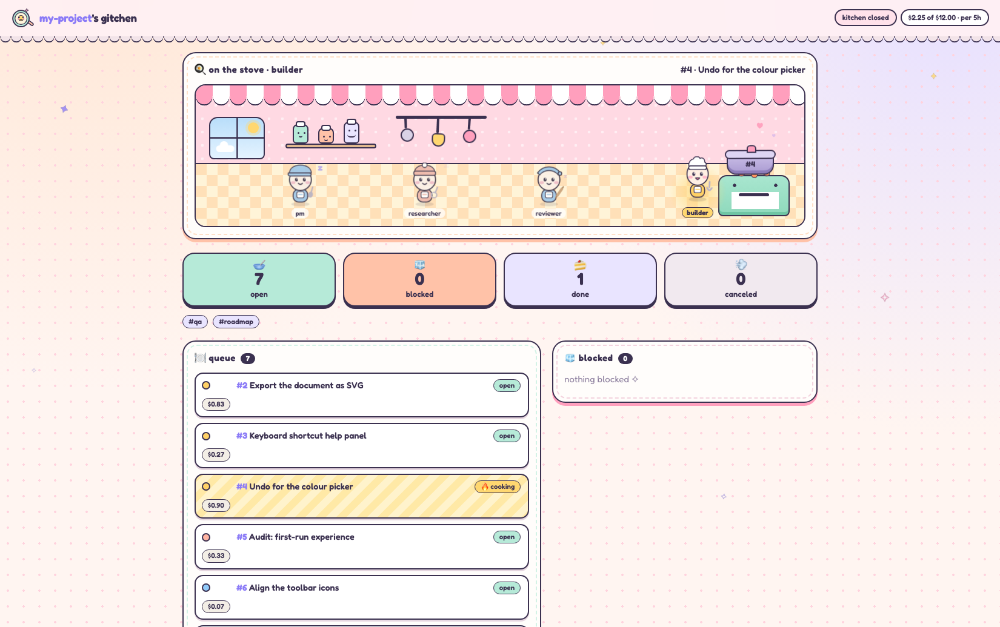

# gitchen



**Git-based agent orchestration.** A tiny kitchen of AI chefs that cook your
issues. Issues are files, roles are prompts, and git remembers everything.

- **Git is the whole pantry.** Every issue is a markdown file
  (`issues/42.md`), every move (create, assign, comment, close) is a commit
  authored by the role that made it, and every issue gets its own branch and
  worktree. No database, no dashboard that knows more than the repo does.
- **You define the roles.** There are none built in. A role is a markdown
  prompt in `agents/`, a model size and a short list of tools. Hand work on
  by assigning the issue: nobody calls anybody.
- **No chef supervising the chefs.** Dispatch is a plain polling loop, not a
  model. Each turn is spawned fresh against one issue, sandboxed in its
  worktree, and sees only the tools it may use. You set a budget.

## How it works

1. **File an order.** Create an issue with an `assignee`, which names a role.
2. **The daemon notices.** An open issue whose assignee isn't already busy
   gets that role spawned against it.
3. **A chef cooks.** The turn runs in the issue's worktree. Its output becomes
   a comment, and its last line says how it went (`built`, `stuck`, ...).
   The instance's `transitions` table decides what that means: a built order
   goes to review, say.
4. **Serve it.** An `approved` review merges the branch into the base. An
   order that waits on others (`blocked_by #12 #13`) cooks again by itself
   once they're done.

The part left to a person is judgment: deciding what to build, what ships,
and what to do with anything a role couldn't finish. You do that from an
interactive session in the instance repo. It isn't a role, and the daemon
never runs it.

## Three repos

| Repo | Holds |
|---|---|
| **gitchen** (this one) | the daemon, the MCP server, the kitchen view, and generic starting prompts in `library/` |
| **an instance repo** (e.g. `my-project-agents`) | one project's `project.yml`, `agents/*.md`, `issues/`, skills and schedules |
| **the project repo** | the product's code, which agents change on `issue/<id>` branches |

gitchen is installed once per machine and run from inside an instance repo;
see [Install](#install). The rest of this README is the reference: the issue
model, configuration, and how each part works.

## The model

An issue (`issues/<id>.md`) has a `state` — one of a small, fixed,
non-project-extensible set: `open` (eligible for dispatch), `blocked` (a
waypoint, not a resting place — needs a privileged look before it can
move again, but isn't a final outcome), `done` (closed, successfully),
`merged` (closed, its commits merged into the base branch), `canceled` (closed, unsuccessfully). Dispatch only cares about `open` vs
not; the `blocked`/`done`/`merged`/`canceled` split exists for whoever's triaging,
not for the framework — same reasoning either way, though: a bare
`open`/`closed` binary would have meant "closed" conveys nothing about
which of those a reader actually needs to know.

An issue also has an `assignee` — never null, always a *role* (an
`agents/<role>.md` exists), defaulting to the role that created it. The
interactive session you work from is not an agent: its identity
(`coordinator`) can file issues but can never hold one, so it must name a
role as the assignee, and `assign_issue`/`NEXT: assign` refuse anything that
isn't a role. And a committed, append-only `assignment_history` of every
delegation (`assign`, a push) and hand-back (`return`, a pop — same word
a call uses for going back to its caller). The daemon's whole job each
tick: for every `open` issue, if its `assignee` has no live holder right
now, spawn that role fresh against it.

A spawned worker/reviewer turn never calls a tool to say what happened —
its raw output *always* becomes a comment on the issue, automatically, and
its last `NEXT: return` / `NEXT: assign <role>` line is
parsed and acted on, re-checked against what that role is actually
permitted to do (`project.yml`'s `allowed_tools`) before anything moves.
A missing/invalid line gets a couple of corrective `resume()` nudges
before the daemon gives up and returns it automatically with a comment
flagging it — an issue is never silently stranded.

Every issue gets its own git worktree against the public repo
(`issue/<id>`, branched from `base_branch` — default: the public repo's
current branch) the moment it's created, whether or not anything ever
ends up committed to it. Not just "code-touching" roles get one:
classifying those generically wasn't worth the complexity, since whether
to merge already depends on whether there are commits, not on what kind
of role was assigned. Created once, reused by every subsequent spawn
against that issue — a builder's second attempt after a rejected review
sees its own first attempt's commits, not a fresh checkout. Pass another
issue's own branch as `base_branch` to stack one on top of another's
in-progress, not-yet-merged work (e.g. a security review that needs to
see the builder's uncommitted-to-main changes) — the same thing picking a
PR's base branch does, not a parent/child link the framework tracks.
Fails soft: if the public repo has nothing to branch from yet, the issue
is still created, just without a worktree; `dispatch.py` falls back to
the shared repo as cwd for it. The framework owns this entirely — a
spawned agent never sees worktree plumbing, just the `cwd` it's handed.

Returning with no one above it blocks the issue. The stack only counts
roles, so an issue a human filed and assigned to `pm` has nobody above `pm`:
when `pm` returns it, the issue is marked `blocked` and the reason is recorded
in its history, and the assignee stays put. Blocking is not canceling: a role
that may not close issues can't end one by returning it, and a person decides
whether it is worth another try. An issue already off `open` keeps its state.
To flag something for a human, a role uses `NEXT: block`.

The daemon never comments on an issue. Comments are what roles report. Things
the framework did or noticed (a circuit breaker trip, a crash, a directive
that never came, a stacked issue unblocking) go in the issue's history as
events, where the next role and the view both see them.

A turn posts exactly one comment, its report, however many times it was asked
again. When the directive is missing or a close is refused (a merge with
unmerged commits, say), the agent is asked again in its own session, with the
reason, and only the final report is posted.

Returning always goes to exactly whoever delegated it — pure history,
not a role hierarchy, so a builder that hands off to a reviewer gets
exactly that reviewer's return, never something skipping past it.
There's no separate "blocked on a sub-issue" state either: fan-out (a
builder needing two independent reviews) is just two ordinary issues, each
with its own stack; each one returning to the builder re-triggers it
on its own, and the builder's own prompt is what checks whether its
sibling is done too — no join-counting in the framework.

A role's mutation surface is deliberately tiny: reads, and `create_issue`
(the one way to ask someone else for work). `update_issue`, `assign_issue`,
`return_issue`, and `comment_issue` are the privileged tier, for the coordinator's own interactive session,
which never passes through the automatic end-of-turn handling above.

Mechanical, non-agentic checks run every tick, before any agent gets
spawned — none of them need an LLM call, so none of them cost anything.
Marking an issue `blocked` (or `canceled`/`done`) is the actual way a
stuck issue escapes the loop — not "return it to the requester" alone,
deliberately: the requester might itself be an automated role (a
researcher, a planner), and a structural guarantee shouldn't depend on
trusting it to notice rather than just reassigning the issue right back.
Since dispatch only ever looks at `state == "open"`, there's no separate
pause-list to configure — moving a state off `open` *is* the pause, and
only a deliberate, privileged `update_issue` moving it back resumes
dispatch (which is also how a project decides who's allowed to do that).
Roadmap items reach `pm` by ordinary assignment; there is no separate
intake pass. The **circuit breaker** counts an issue's turns (one turn posts
exactly one comment) since a person last reopened it, and past `MAX_COMMENTS`
marks it `blocked`, recording why as an event. Reopening it by hand gives it
a fresh count; the daemon's own reopens never do. It's a backstop for when a role's *own* escape logic (e.g.
`pm.md` marking something `blocked` after two failed reviews) fails to
trigger — a bug, prompt drift — set well above what a normal cycle takes
specifically so it almost never fires; if it ever does, that's itself a
signal to look at the role's prompt, not just the issue.

A genuinely *unexpected* crash (a bug, bad config, a corrupt file — not
the model's judgment) is handled separately from all of the above: it blocks
the issue with the exception as the reason, keeps the assignee so reopening
retries the same role, and never retries invisibly.

A turn that never ran (a usage limit, an outage, a CLI that won't start) is
different again. It says nothing about the work, so the issue is left exactly
as it was, and dispatch pauses with a wait that doubles up to half an hour. A
turn that completes clears the pause. A turn that spent tokens and then failed
is not re-run blindly, since it may have changed files.

The only other thing that creates an `open` issue without a role's own
judgment is `schedules.tick()` — the sole remaining use for cron. A
schedule never fires an agent directly: on each cron match it creates an
issue (frontmatter: `cron`, `assignee`, optional `title`/`labels`/
`priority`/`folder`; body = the issue body) with a configured `assignee`,
exactly as if a human had called `create_issue`, and the normal dispatch
pipeline picks it up from there — same worktree, same end-of-turn contract,
same circuit breaker. Time is just another way an issue is born; nothing
downstream of that treats it differently. A schedule skips its match while
the issue it filed last is still `open` or `blocked`, so a long round (one
waiting on its own work with `blocked_by`) is never stacked with the next.

## What's here

- `mcp/issues.py` — one addressable, mutable record per id at
  `<project_root>/issues/<id>.md` (frontmatter: `title`, `state`
  open/closed, `labels`, `priority`, `assignee`, `assignment_history`;
  body + a `## Comments` section). Kept out of any role's files on purpose: labels
  + priority make "the roadmap" a *query* (`list_issues(label="roadmap",
  state="open")`, sorted by priority) instead of a flat file someone
  hand-edits. Real concurrency, because a coordinator connection and a
  scoped worker/reviewer connection can be alive at once against the same
  checkout:
  - `update_issue` is whole-file optimistic-locked: every read returns a
    content hash; a write must supply it, a mismatch returns the fresh
    state instead of just erroring. Deliberately can't touch
    `assignee`/`assignment_history` — those only ever move through
    `push_assignee`/`return_assignee`, never an arbitrary patch.
  - Comments, push/return, and id assignment are plain locked (`flock`, held
    only for the one read-modify-write) — naturally conflict-free
    operations if just serialized, so a hash check there would only cause
    pointless retries.
  - Every mutation is attributed to an identity derived entirely from how
    the connection was launched (never a tool argument) — and that same
    identity is the literal git commit author, not a separate field to
    keep in sync.
- `mcp/worktrees.py` — one git worktree per issue against the public repo,
  created lazily on an issue's first actual dispatch (not at `create_issue`
  time — an issue that's never dispatched, e.g. one created already
  closed, never pays for one) and reused by every subsequent spawn against
  that issue. See "The model" above.
- `mcp/holders.py` — the runtime (never committed) mutex over "which live
  instance may act on this issue right now." Separate from `assignee` on
  purpose: assignee is durable fact that belongs in git; a holder only
  means anything while its process is alive, same bucket as the MCP
  connection singleton pidfile — gitignored, local, disposable. A stale
  holder (crashed without releasing) is indistinguishable from "never
  spawned" once cleared, which is the entire crash-recovery story: no
  special case, just a fresh attempt on the next tick.
- `mcp/dispatch.py` — the daemon's per-tick scan. Each tick starts at most one
  turn, and only while the instance's budget has room. Work already under way
  goes first: every hop an issue makes (builder to reviewer, back) is spawned
  on the next tick, then priority decides, then age. There is no cooldown.
- `mcp/budget.py` — the instance's spending limit (see "Budget and cost").
- `mcp/cost.py` — what each turn cost, per model, as the harnesses report it.
- `mcp/retro.py` — `gitchen retro`: what the turns cost, by role and model.
- `mcp/server.py` — stdio MCP server (plain stdlib JSON-RPC, no `mcp` SDK
  dependency). Exposes reads (`get_issue`, `list_issues`), `create_issue`,
  and the privileged tier (`update_issue`, `assign_issue`, `return_issue`,
  `comment_issue`).
  Takes an optional `--role <name>`, scoping
  that one connection to `project.yml`'s `allowed_tools[name]` list — see
  "Scoping tools per agent" below. Enforced here, in the server itself,
  not by trusting a harness's own CLI flags — it has to hold the same way
  no matter which harness spawned the caller.
- `context.md` (optional, instance-repo root) — prose, not config, read by
  `dispatch.py` and unconditionally included in every spawned prompt. The
  thing `project.yml`/`registry.yml` are *not*: those are config for our
  own code, never read by an agent; `context.md` is for agents, in plain
  language — e.g. the project's label vocabulary, so "mission"/"roadmap"/
  "decision" mean the same thing every time without a human-maintained id
  list anywhere.
- `mcp/harness.py` + `mcp/harnesses/` — the harness interface and its
  adapters: `claude_code.py` (one blocking `claude -p` per turn) and
  `omp.py` (one `omp -p --mode json` per turn). `process.py` is the shared
  "run it and reap anything it left running" half, `sandbox.py` the shared
  OS-sandbox prefix. A harness adapter's job stops at "how do I point this
  specific CLI at this specific MCP server for this invocation" — it never
  decides what that connection is allowed to do.
- `mcp/registry.py` + `bin/gitchen sync` — the shared-content registry:
  resolves `registry.yml` entries (`<repo-alias>//<path>[@<ref>]`) and
  materializes them into plain local files, so reuse never requires an
  override mechanism — each resource has exactly one source. A repo alias
  can be a local sibling path (the common case) or a remote git URL
  (`https://`, `git@`, `ssh://`, anything ending `.git`) — pinning is just
  git history either way: `git show <ref>:<path>` against a local repo's
  own `.git`, or against a cached mirror clone (`~/.cache/gitchen/repos/`,
  override with `GITCHEN_CACHE_DIR`) refreshed on demand for a remote one.
  There's no separate pin step: `sync` resolves a still-floating source
  against its current commit and immediately records that commit as its
  pin, so every sync leaves every source pinned. To go back to floating,
  edit the `@<ref>` out of `registry.yml` by hand and sync again — that's
  the whole "unpin," no command needed for it.
- `library/agents/{builder,reviewer,researcher}.md` — genuinely
  product-agnostic role prompts: discover the repo's own build/test
  tooling rather than assuming one, read/verify rather than trust a
  self-report. A project points its own `agents/<role>.md` at these via
  `registry.yml` unless it has a real reason to diverge — see
  an instance repo's `registry.yml` for the pattern. `library/skills/` is the
  same for generic skills, pinned per file (`skills/<name>/SKILL.md`).
- `mcp/schedules.py` — the only thing cron does in this framework:
  create an issue, on a match, with a configured assignee. No agent is
  ever fired directly from a cron match — the created issue just enters
  the normal dispatch pipeline like any other. See "The model" above.
- `mcp/daemon.py` + `bin/gitchen daemon` — a background process that
  loops `schedules.tick()` then `dispatch.tick()` and nothing else. No
  OS cron/launchd/systemd, and not Claude Code's own session-only
  `/schedule` either (that dies with the session, and would be the same
  kind of harness-specific magic the rest of this framework avoids) —
  just a plain poll loop whose only jobs are creating issues on a
  schedule and noticing issue state, repeatedly.

## Install

One-time, per machine, not per project:

```
ln -s ~/Code/gitchen/bin/gitchen ~/.local/bin/gitchen   # anywhere on PATH
```

`bin/gitchen` resolves its own real location through the symlink
(`Path(__file__).resolve()`), so every project just runs the bare `gitchen`
command — no submodule, no per-project copy, no absolute path in any
project file. The tradeoff: there's no per-project pin, every project
always runs whatever's currently checked out in `~/Code/gitchen`. Fine
for one person on one machine; if that ever stops being true, a project
can still vendor a specific commit via the shared-content registry's
`@<ref>` pinning instead (same mechanism, just pointed at this repo).

## The kitchen view (read-only)

A separate process, deliberately not part of the daemon — start and stop it
whenever you like:

```
gitchen web --project-root ~/Code/my-project-agents
# http://127.0.0.1:8787
```

It reads the same files the daemon writes (`issues/`, `.agents-daemon/`)
and serves an overview — the kitchen scene (the cooks on the line, the
active order on the stove), clickable state counters, scopes and labels that
filter the open and blocked queues, and a schedules button that opens each
job's full text and when it last fired — plus one page per issue with its
body, scope and notes. Live updates come
from an SSE endpoint (`/events`) that watches file mtimes, plus a 10s poll
because some proxies (a cloudflared quick tunnel, for one) buffer SSE;
there is no write endpoint at all.

- **Roles come from `project.yml`** (`role_settings` / `allowed_tools`
  keys), so another project's roles get their own little workers and
  colours. Nothing is hardcoded to this project's roles.
- **Click a cook** to read what that role loads: its system prompt
  (`agents/<role>.md`, frontmatter stripped), its edit scope and the roles it
  may assign to, and — while it is running — the issue, its body and
  assignment history, plus the role-specific prompt that turn received.
  Shared `context.md`, the workspace rules, the posting rules and the
  directive rule are omitted because every role loads them identically; the
  role's actual directive values stay as a compact footer. The same prompt
  builder the dispatcher uses assembles the rest, so the panel cannot drift
  from what the agent actually gets.
- `--tunnel` also spawns `cloudflared tunnel --url http://127.0.0.1:<port>`,
  prints the public URL and writes it to `.agents-daemon/web-tunnel.url`.
  No token: the unguessable URL is the access control, and the view is
  read-only by construction.
- The page is plain files in `web/` (no build step). Its rounded type is
  Fredoka, bundled as a subset woff2 under the SIL OFL (`web/fonts/`), so
  the view looks the same offline and on a phone.
- **Artifacts:** every dispatched prompt names the turn's artifacts folder
  (`.agents-daemon/shared/<issue>/<turn>/`, outside the worktree). An agent
  shares a file by linking to it in its report with a plain markdown image
  or link (``, `[run log](out/run.log)`);
  when the turn ends the daemon copies each linked file into that folder and
  rewrites the link. A link to a file the repo tracks is left alone. The view
  serves images, PDFs and text-like files (as plain text, never HTML).
- `?nosse` disables the live stream (useful for screenshots/printing; an
  open EventSource keeps headless tools waiting for network idle).

Endpoints: `/api/overview`, `/api/issues`, `/api/issues/<id>`,
`/api/activity`, `/api/health`, `/events`.

## Outcomes and transitions

A role says how its work went in one word, its **outcome**, and declares the
outcomes it can report in its prompt's frontmatter:

```yaml
outcomes: {built: the change is committed and tested, stuck: it cannot be done as specified}
```

The instance's `transitions` table says what each outcome does:

```yaml
transitions:
  builder:  {built: assign reviewer, stuck: return}
  reviewer: {approved: merge, rejected: return}
```

`assign <role>` pushes the issue onto the assignment stack, and `return` pops
it back to whoever pushed it. `done`, `merge`, `cancel` and `block` close it.
A role listed in the table is offered only its own outcomes, and only those
are read from its report, so the table is the authorization: a reviewer can
merge without a tool. The table is checked when the project loads, so an
outcome the role doesn't declare, a verb that isn't known, or an `assign` to
something that isn't a role is refused with the place it is wrong. A role not
in the table keeps the plain directives: `return`, `assign`, `done`, `merge`,
`cancel`, `block` and `blocked_by`.

**Waiting** is `NEXT: blocked_by #12 #13`. The issue is blocked until every
issue named has closed, and then it opens by itself on the next tick. A wait
that can never be met (a cycle, a missing issue, issues that are all finished)
is refused and sent back to the role. A stacked child waits for its parent and
is retargeted onto the parent's base when the parent merges. Without
`blocked_by`, a stacked child runs at once on its parent's branch. What the
child's base becomes when the parent closes:

| The parent closes as | A child that waited with `blocked_by` | Its `base_branch` |
|---|---|---|
| `done` | opens | stays on `issue/<parent>` |
| `merged` | opens | moves to the parent's own base |
| `canceled` | opens | stays on `issue/<parent>` |

A parent still open or in review keeps its child blocked.

**Ordering** is `move_issue(id, before=…)` or `after=…`. Only the moved issue's
priority changes, and the queue is renumbered only if the two neighbours have
no room between them.

## Folders and edit scopes

Issues may sit in folders under `issues/`. The instance declares them in
`project.yml` (`folders:`). It may also name where an issue goes when none is
given (`default_folder:`); without that, `create_issue` must pass `folder`
explicitly whenever the project declares folders. An issue's folder is its
place on disk, not a label: the framework never reads labels for this.

```yaml
folders: [product, company]
default_folder: product
edit_scopes:
  pm: [product]
```

A role with an `edit_scopes` entry may change only the issues in those folders.
Anything outside them it asks for by filing a new issue in that folder, which
is never scoped. A role with no entry may edit everything, and so may the
coordinator. Ids stay unique across folders. An `edit_scopes` entry can only name
a declared folder, and a folder name is lowercase letters, digits and hyphens.

## Squash merges

By default a `merged` issue fast-forwards its branch into the base, so every
commit a turn made lands as written. With

```yaml
merge: {squash: true, author: "Jane Doe <jane@example.com>"}
```

the daemon lands it as one commit it writes itself: the branch's exact tree, the
issue title as the whole message, and `author` as author and committer (the
repo's own git identity when `author` is left out). It is written with
`git commit-tree`, so no hook runs and nothing from the turns' own commits
(messages, trailers, identities) reaches the base. The issue branch is then
moved to that commit, so it has nothing the base lacks. Write issue titles as
the commit subjects they will become.

## Parallel turns

`max_parallel` in `project.yml` says how many turns may run at once (one by
default). Each turn holds its own issue, so the same role may run on several
issues together, and a started issue still goes first. The slots are claimed
before a turn's thread starts, so two ticks can't take the same one. A manual
`gitchen tick` always runs a single turn.

Turns keep to their own ports: each issue gets a range of ten, passed to its
turns as `PORT`, so two test servers never share a port or test each other's
code. Writes to the instance repo are serialized, and every commit names its
own paths, so one commit never carries two issues.

A branch the base has moved past is rebased in its own worktree and sent back
to be checked again on its new base before it lands. A conflict is refused with
the files named, and the branch is left as it was. The daemon never runs tests:
that is the reviewer's job.

Stopping the daemon ends the turns it started, so a stop never leaves a turn
running with nothing to report to.

## Program roles and scheduled jobs

A role whose prompt names a script (`run: scripts/collector.py` in its
frontmatter) is run as that script, not a model. The script is a `.py` file
(run with this Python) or an executable file; the project refuses to load
when the named script is missing, or is a shell script without the executable
bit. The script gets the turn's
prompt on stdin and its working folder, and what it prints is the report; a
last line `NEXT: ...` works as it does for an agent. It reaches the gitchen
tools with `gitchen call <tool> '<json>'`, which the daemon authorizes exactly
as it would an agent's call, and it spends no model tokens, so it records no
cost.

A schedule may name a program role instead of an assignee: `run_role: collector`.
It runs the program with no issue at all, holds a slot under its own name, and
leaves nothing behind unless it calls the tools to change something. Its output
goes to the daemon log.

## Draining the daemon

`gitchen daemon stop --drain` asks the daemon to take no new turns, wait for the
running ones to finish, and leave on its own. `--timeout` (default 30 minutes) is
how long to wait before it is terminated. A drain is a request on disk: a completed
turn doesn't cancel it, so the daemon can't start work again partway through.
`gitchen daemon stop` without `--drain` terminates the daemon, and that ends the
turns it started, so their issues are run again later. `gitchen daemon start`
clears any old drain request.

## Budget and cost

Each turn's cost is recorded on its issue, per model, in the same commit as its
report, so a report and its cost never get out of step. Costs are at list
price: on a subscription they are a meter, not a bill.

An instance sets its own limit in `project.yml`:

```yaml
budget: {usd: 30, per: 5h}   # a rolling window
budget: {usd: 3}             # until someone resets it
```

When spending reaches the limit, no new turn starts, and an issue in the
middle of its work waits where it is. Nothing is anticipated: a turn that has
started always finishes, so spending can go a little past the limit. The limit
is per instance rather than per account, so a person's own sessions keep their
headroom.

- `gitchen budget` shows the window's spending.
- `gitchen budget reset` counts spending again from now. This is the person's
  gate; the read-only view shows the state but can't change it.
- `gitchen retro --since 7d` totals what the turns cost, by role and model, and
  lists the costliest issues.
- `gitchen tick` goes past a spent budget and a pause, on purpose.

A turn that never ran (a usage limit, an outage) pauses dispatch with a wait
that doubles up to half an hour. Nothing on the issue changes, and the same
issue carries on once a turn completes.

## Machine config

Which CLI actually runs a turn — and what `small`/`medium`/`big` mean on
this machine — is not a project decision. It lives in
`~/.config/gitchen/config.yml` (`$GITCHEN_CONFIG` overrides the path,
`$XDG_CONFIG_HOME` is respected).

**You don't have to write it.** On first use gitchen detects the agent CLIs
on PATH (`omp`, `claude`), picks one, and writes the file — including the
sandbox block: the `gitchen` profile (installed on first use), npm's cache
and registry when npm is present, the common model-API hosts so the sandbox
is in proxy mode from the start, and `small`/`medium`/`big` as effort
levels on each CLI's own default model (`thinking` for omp, `effort` for
Claude Code). If nono isn't installed it writes `sandbox: false` and says
so. `gitchen config` prints the file; `gitchen config init --force`
regenerates it from what's installed now. Once it exists, gitchen never
rewrites it.

What it looks like:

```yaml
harness: omp                     # the adapter every turn uses
harnesses:
  omp:
    settings: {binary: omp}
    sandbox:                     # nono under the hood; the project never names it
      profile: gitchen           # gitchen ships this one; installed on first use
      allow: ["~/.npm"]
      allow_domains: [api.deepinfra.com, registry.npmjs.org]
  claude-code:
    settings: {binary: claude, permission_mode: bypassPermissions}
    sandbox:
      profile: gitchen
      allow_domains: [registry.npmjs.org]
models:
  small:
    omp: {model: deepinfra/deepseek-ai/DeepSeek-V4.1-Flash-1017, thinking: low}
    claude-code: {model: claude-haiku-5-5}
  medium:
    omp: {model: deepinfra/deepseek-ai/DeepSeek-V4.1-Flash-1017, thinking: auto}
    claude-code: {model: claude-sonnet-5-5}
  big:
    omp: {model: deepinfra/deepseek-ai/DeepSeek-V4.1-Flash-1017, thinking: high}
    claude-code: {model: claude-opus-5-5}
```

A role's settings are `harnesses.<harness>.settings`, then the alias's
entry for that harness on top. `sandbox` is passed through as
`settings["sandbox"]`; an adapter that doesn't sandbox simply ignores it.

`profile: gitchen` is gitchen's own profile (`profiles/gitchen.json` in
this repo): it is installed into `~/.config/nono/profiles/` on first use,
with the port policy for the current platform filled in — macOS grants
`open_port: [0]` ("every localhost port"), Linux gets an
`open_port_range` instead, because nono's `0` means a literal port there.
Bump the profile's `meta.version` to ship a change; a machine that already
has that version (or newer, e.g. locally edited) is left alone. Any other
profile name is one the machine already manages; gitchen only names it.

A missing `sandbox` key is an error, not a silent no-sandbox: the adapters
auto-approve tool calls, which is only safe inside one. Write
`sandbox: false` to run turns unsandboxed on purpose.

## The contract an instance repo must satisfy

An instance repo (e.g. `my-project-agents`) needs:

- `project.yml` at its root:
  ```yaml
  public_repo: ../my-project   # relative path to the project's cwd for spawned agents
  directive_retries: 2                 # corrective resume() attempts before auto-return
  role_settings:                       # which model alias each role wants
    builder: {model: small}
    reviewer: {model: small}
    pm: {model: medium}
  allowed_tools:                       # the one place MCP permissions are set
    builder: [list_issues, get_issue]
    pm: [list_issues, get_issue, update_issue, create_issue, assign_issue]
  ```
  `model` is an **alias**, not a model id: `small`, `medium`, `big` mean
  whatever this machine's config says they mean (see "Machine config"
  below). A project never names a harness, a provider, a model id, or a
  sandbox — those are machine facts, and a project.yml that tries to set
  them is rejected rather than silently ignored.
- `agents/<role>.md` for every role that appears as an `assignee` anywhere.
  Markdown with YAML frontmatter (`name`, `description`), body = the system
  prompt — same shape Claude Code's own subagents, OpenCode agents, and
  Cursor skills use. A role with no file here is simply never spawned by
  the daemon, and nothing can be assigned to it: a role *is* its prompt file.
  Optional `skills: [name, ...]` lists the skills that role preloads, as in a
  Claude Code subagent: the daemon injects each one's full `SKILL.md` into the
  role's prompt, on any harness. A role gets only the skills it lists.
- `skills/<name>/SKILL.md` (optional), in the standard Agent Skills format
  (frontmatter `name`, `description`; body = instructions; other files in the
  folder for anything it refers to). One folder serves both the roles that
  list a skill and the person coordinating. A skill marked
  `disable-model-invocation: true` is for a person to invoke only: a role that
  lists it, like one that lists a skill that doesn't exist, is refused when
  the daemon loads the project.
- Static reference material (mission, decisions, catalogs) is issues like any
  other, under the instance's own conventions. There is no separate knowledge
  store: a second editing mechanism would only duplicate the issue one.
- `schedules/*.md` (optional — only needed for anything genuinely
  time-based): frontmatter `cron` (standard 5-field), `assignee`
  (required — who the created issue goes to), optional `title`/`labels`/
  `priority`/`folder`; body = the issue's own body. Each match creates one
  issue, unless the one it filed last is still unfinished — see "The model"
  above for why that's the whole feature.

## Running the server

```
gitchen serve --project-root .
```

Wire it into Claude Code via `.mcp.json` in the instance repo — this is
the entire file, no path back to `gitchen` anywhere in it:

```json
{"mcpServers": {"gitchen": {"command": "gitchen",
  "args": ["serve", "--project-root", "."]}}}
```

## Scoping tools per agent

Today, a dispatched worker/reviewer agent either doesn't talk to this MCP
at all (no entry in `allowed_tools`, same as a builder with no write
access needed), or gets a connection scoped to exactly the handful of
*read* tools in its `allowed_tools` entry — never the privileged tier:

```yaml
allowed_tools:
  reviewer: [list_issues, get_issue]
```

`tools/list` only returns that subset; `tools/call` rejects anything else
with a JSON-RPC error — enforced by the server, so it's true regardless of
which harness is on the other end of the connection. **What stays
harness-specific** is only the wiring: however a given harness's adapter
tells its CLI to attach a particular MCP server to a particular invocation
(a project-level `.mcp.json`, a `--mcp-config` flag, an env var, whatever
that harness supports) is that adapter's problem to solve in
`mcp/harnesses/<name>.py` — the enforcement above never changes
based on the answer, and a harness with no way to attach a custom MCP
server per invocation just doesn't get to offer its spawned agents MCP
access at all, which is a safe default, not a broken one.

## Running the daemon

```
gitchen daemon start --project-root ~/Code/my-project-agents
gitchen daemon status --project-root ~/Code/my-project-agents
gitchen daemon stop --project-root ~/Code/my-project-agents
```

(`--project-root` works before or after the subcommand; from inside the
instance repo itself it defaults to `.`, so plain `gitchen daemon start` is
enough.)

`start` backgrounds the loop (`start_new_session=True`, detached from the
calling terminal) and writes a pidfile + log under
`<instance-repo>/.agents-daemon/` (gitignored — it's runtime state, not
an issue). It polls every 20s by default (`--poll-seconds`): each tick
calls `schedules.tick()` (create any due issue) then `dispatch.tick()`
(the circuit breaker, then spawning against any `open` issue
whose assignee has no live holder and nothing paused or over budget). `daemon
run` runs the same loop in the foreground, for debugging.
`bin/gitchen`'s own job stays narrow: start the MCP server, manage the
daemon process, and `sync`, which (unlike an MCP tool) has to work before
any server or agent session exists yet.

This needs *something* to start it once per boot if you want it surviving
a restart of the machine — a login item, `@reboot` in cron, a launchd
keepalive, whatever fits — running `bin/gitchen daemon start` once. That's
a deliberate choice, not an oversight: `serve()` never starts, stops, or
otherwise touches the daemon as a side effect of some agent connecting.
The MCP server's job is answering tool calls; the daemon's uptime is its
own explicit lifecycle, kept separate on purpose
(`test_server_singleton.py` covers both — an unrestricted or scoped
connection never starts it, and connecting never disturbs one already
running).

## Known gaps

- Dispatch correctness still depends on a spawned agent actually ending
  its turn with a valid `NEXT:` line (or on the bounded retry/auto-return
  fallback catching it) for any step that genuinely needs an LLM's
  judgment. Intake, the circuit breaker, and now scheduled issue creation
  are the fully deterministic, non-agentic steps in this pipeline — more
  of it could plausibly move that way (a "deterministic agent" mode), but
  that's future work, not yet designed, for whatever in a given project's
  role set turns out not to need real judgment either.
- No multirepo support: `public_repo` is one fixed path on `ProjectConfig`,
  not a per-issue property, even though nothing in the issue/dispatch model
  conceptually requires that.
- Worktree cleanup is partial. The daemon removes the worktree of a `done`,
  `merged` or `canceled` issue on each tick (a few at a time), but keeps one
  that still holds untracked files until those files were last written ten
  days ago. Branches are never deleted, so the work stays in git.

## The landing page

`site/` is the landing page: plain static files, no build step. It is deployed to
GitHub Pages by `.github/workflows/pages.yml` on every push to `master`, and
`tests/test_site.py` guards its relative paths. In the repo's Settings → Pages,
set the source to "GitHub Actions" once.

## Tests

```
python3 -m pip install -r requirements.txt
python3 -m pytest tests/
```

`tests/test_claude_code_harness.py` exercises the harness adapter against a
stub `claude` binary — no real agent turn is spawned. `tests/test_issues.py`
exercises the push/return pointer model and optimistic locking.
`tests/test_holders.py` exercises the runtime mutex, including stale-pid
recovery. `tests/test_dispatch.py` exercises the end-of-turn contract
(one comment per turn, `NEXT:` parsing, permission checks, corrective
retries, refusals sent back to the agent), the events the daemon records
instead of comments, the provider-failure pause, and the circuit breaker, with
a fully fake harness. `tests/test_sandbox_git.py` runs the git grants under
real nono and checks the results from the host side. `tests/test_schedules.py`
exercises cron matching and the once-per-minute dedup on issue creation.
`tests/test_worktrees.py` exercises worktree creation,
stacking on another issue's branch, and the fail-soft path against
throwaway git repos. `tests/test_registry.py` exercises sync's auto-pin
and manual-unpin-by-edit against throwaway git repos.
